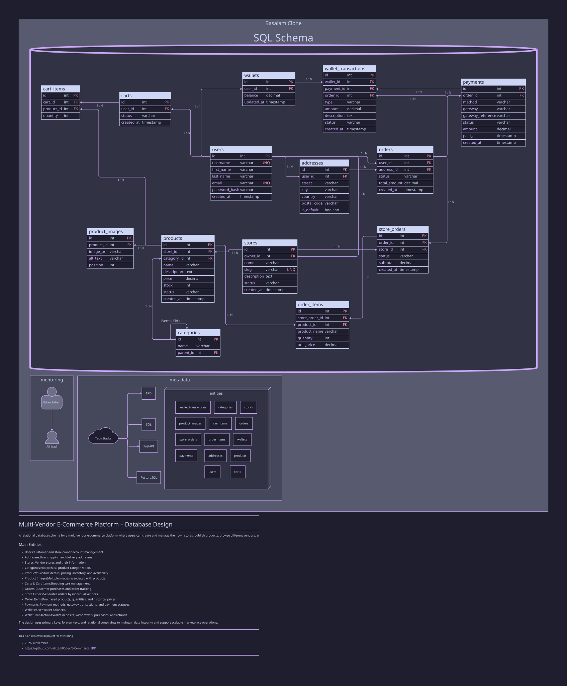

# Multi-Vendor E-Commerce Database ERD



A database-design project for a multi-vendor e-commerce platform. The
schema models customers, vendor stores, product catalogs, shopping
carts, orders, payments, and user wallets.

The ERD is written in [D2](https://d2lang.com/), a declarative
diagramming language. The source file is `database.d2`; the commands
below generate an SVG or PNG diagram from it.

## Main entities

---

Entity Purpose

---

`users` Customer and store-owner accounts

`addresses` User shipping addresses

`stores` Vendor stores owned by users

`categories` Hierarchical product categories

`products` Products, prices, and stock

`product_images` Images belonging to products

`carts` Shopping carts belonging to users

`cart_items` Products and quantities in carts

`orders` Customer orders

`store_orders` Vendor-specific portions of an
order

`order_items` Products purchased in each store
order

`payments` Payment attempts and gateway
details

`wallets` User wallet balances

`wallet_transactions` Wallet deposits, withdrawals,
purchases, and refunds
-----------------------------------------------------------------------

## Application-Level Authentication

Authentication is implemented without changing the database schema:

- Passwords are stored in `users.password_hash` as salted bcrypt hashes of `SHA-256(password)`.
- Legacy SHA-256 hashes are accepted and upgraded on the next successful login.
- Login issues stateless JWT access tokens; no session or token table is persisted.
- Admin privileges are resolved from the `ADMIN_EMAILS` environment variable, not from a database column.
- Ownership checks use existing foreign keys such as `stores.owner_id`, `carts.user_id`, `orders.user_id`, and `wallets.user_id`.

No new tables or columns were added for auth.

## Integrity Constraints

Phase 2 added database-level checks and Alembic migrations:

- Non-negative: `products.price`, `products.stock`, `product_images.position`, `orders.total_amount`, `store_orders.subtotal`, `order_items.unit_price`, `wallets.balance`.
- Positive: `cart_items.quantity`, `order_items.quantity`, `payments.amount`, `wallet_transactions.amount`.
- Allowed status values are enforced for stores, products, carts, orders, store orders, payments, and wallet transactions.
- Payment methods: `wallet`, `gateway`, `card`.
- Wallet transaction types: `credit`, `debit`.
- Unique constraints: one wallet per user, unique cart items per product, one store portion per order.
- Schema is managed by Alembic; the application no longer calls `create_all` at startup.

## Requirements

- Linux, macOS, or Windows
- [D2](https://d2lang.com/) installed and available in your `PATH`
- The D2 source file: `database.d2`

## Install D2

### Linux

Install D2 using the official installer:

```bash
curl -fsSL https://d2lang.com/install.sh | sh
```

If the installer reports that the executable directory is not in your
`PATH`, follow its instructions or add the reported directory to your
shell configuration.

Verify the installation:

```bash
d2 --version
```

### macOS

With Homebrew:

```bash
brew install d2
```

### Windows

Follow the installation instructions in the [official D2
documentation](https://d2lang.com/tour/install/).

## Run the project

1. Open the project directory.
2. Open a terminal in that directory.
3. Generate the ERD as an SVG:

```bash
d2 database.d2 database.svg
```

1. Open `database.svg` in a browser or an SVG-compatible image viewer.

To generate a PNG instead:

```bash
d2 database.d2 database.png
```

To choose a layout engine explicitly:

```bash
d2 --layout tala database.d2 database.svg
```

## Live preview while editing

Run D2 in watch mode so the output is regenerated when the source
changes:

```bash
d2 --watch database.d2 database.svg
```

Keep this command running, edit `database.d2`, and reopen or refresh the
generated SVG to see the updated diagram.

## Project structure

A simple directory layout is:

```text
.
├── database.d2     # D2 source: database entities and relationships
├── database.svg    # Generated ERD (created by the build command)
└── README.md       # Project documentation
```

Generated image files are build outputs. The source of truth is
`database.d2`.

## Important database-design notes

The D2 diagram documents the intended schema; it does not create or
migrate a real database. SQL data types, nullability, unique
constraints, indexes, referential actions, and business rules must also
be implemented and validated in the target database.

For a production implementation, review at least the following:

- Enforce one wallet per user with a unique constraint on
  `wallets.user_id`.
- Prevent duplicate products in a cart with a unique constraint on
  `(cart_id, product_id)`.
- Prevent duplicate store portions in an order with a unique
  constraint on `(order_id, store_id)`.
- Store an order-time snapshot of product names, prices, and shipping
  details.
- Update wallet balances and transaction history atomically using
  database transactions.
- Define appropriate stock reservation and payment-failure handling.

## Useful links

- [D2 documentation](https://d2lang.com/)
- [D2 installation guide](https://d2lang.com/tour/install/)
- [D2 GitHub repository](https://github.com/terrastruct/d2)
